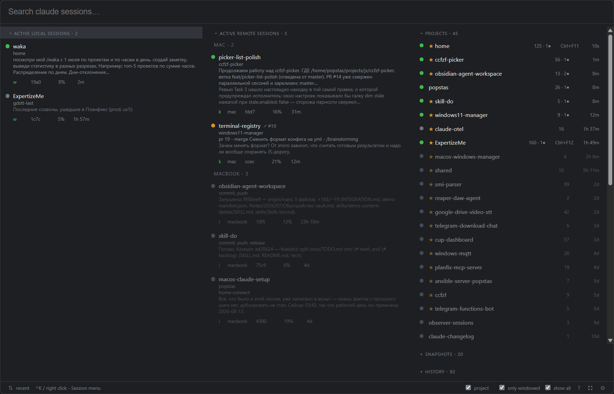
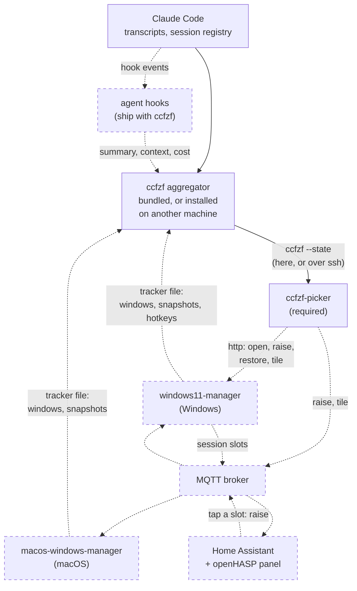

# ccfzf-picker

A picker for Claude Code sessions living on a remote machine. The list arrives
over ssh from the `ccfzf` aggregator, the window and global hotkeys are Tauri 2,
and a session opens in the terminal of your choice.



*[Русская версия](README_ru.md)*

## Features

- **One search line for every panel** — with five mode prefixes (`/l`, `/r`,
  `/h`, `/p`, `/s`) to narrow to one. A forgotten keyboard layout still finds
  it: `зшслук` matches `picker`.
- **Sessions from every machine** — yours on the left, other machines' in the
  middle, grouped by host and ordered by freshness.
- **Projects panel** — favourites, session counts, per-project hotkeys, and a
  dim of everything that does not belong to the project you point at.
- **Status at a glance** — a colored circle per session (working, asking,
  finished-unread, background command running, idle, closed), the terminal it is open in, context used
  (lighter from 15%, yellow from 30%, red from 40%; thresholds in settings),
  minutes left on the prompt cache (yellow under 30, red under 15), and the age
  of the last activity.
- **Enter opens the session** — in a terminal, or back inside Claude Desktop for
  the sessions that came from it.
- **Reopen disconnected sessions** — a session whose ssh link died while the
  agent lived on (the laptop slept, the network dropped) gets a hollow circle.
  `^K` → **Reopen session**, or **Reopen disconnected sessions** in the tray menu,
  stops the orphaned agent and resumes it in a new terminal; the dead window is
  left as it is. The sign comes from `ccfzf` and works on Linux ssh hosts.
- **`^O` opens the folder in your editor** — Zed, VS Code or Cursor, whichever
  is installed, or the one you pick in settings. With Zed, **Use SSH Remote**
  opens remote sessions over SSH instead of a network drive, so Zed notices
  files the agents change and warns before overwriting them.
- **Raises windows instead of opening new ones** — together with a window
  tracker for your system, see [Stack](#stack).
- **Tile and cascade layouts** — a global hotkey asks the tracker to arrange the
  windows in the order you see in the list.
- **Layout snapshots** — `^S` restores a whole remembered arrangement of
  sessions, or one window out of it. When there is nothing to show, the
  Snapshots block stays and says why — `no data` while this machine's tracker
  is silent, `0` when it simply hasn't taken any yet.
- **Wide mode** — `^F` turns the list into a dashboard: a session card next to
  blocks of groups, projects and snapshots, each with its own scroll.
- **Configurable without editing files** — a settings window for hotkeys,
  columns, panel layout, window size and MQTT.
- **Works with the window closed** — background polling keeps the list ready and
  the aggregator's dump fresh for Home Assistant and openHASP.

## Stack

The picker is one part of a small stack, and **the only part you have to
install**. On its own it lists the Claude Code sessions of the machine it runs
on: the aggregator is bundled into the binary. Everything else is optional, and
each piece adds features to the same window.



| Part | Install it when | What it adds |
|---|---|---|
| **ccfzf-picker** | always | The session list of this machine (`localSource: true`), search and modes, the projects panel, status circles, the prompt-cache timer, Enter to resume in a terminal or in Claude Desktop, `^O` to open the folder in an editor, the `^K` menu, wide mode, the settings window. The bundled aggregator needs `bash` and `python3` on Linux and macOS, `python` on `PATH` on Windows. |
| **[ccfzf]** on another machine | the agents run elsewhere | That machine's sessions, read over ssh (`sshHost`); there it is also an fzf picker in the terminal. One remote machine, merged with this one's list. |
| **Agent hooks** (part of ccfzf) | you want more than the status | The last prompt and the agent's last reply under each row, context used, cost, the permission request a session waits on, the PR link, a session kept live across `/clear`. They need `bash` and `jq`, so not on native Windows. Without hooks the status, the agent's question, the cache timer and the compaction mark still come — read from the transcript tail. |
| **[windows11-manager]** | Windows | Terminal windows bound to sessions: the window letter in the row, Enter raises the open window instead of starting a second one, sessions open in their Windows Terminal profile, per-project hotkeys, layout snapshots that restore, tile / cascade / group layouts, seen and unread marks shared with the tracker and the taskbar button, taskbar buttons of dimmed sessions hidden by the `hide dimmed windows` checkbox, and the WezTerm bell sound its `wezterm.lua` plays, muted from the picker's status line. Its file reaches the aggregator through a shared folder; it talks to the picker over http, no broker needed. |
| **[macos-windows-manager]** | macOS | Terminal windows bound to sessions, tile and cascade layouts, layout snapshots (the picker restores them itself, session by session). Its file reaches the aggregator over ssh, and the bundled one as well. Raising a window on Enter and tiling from the picker need an MQTT broker; without one the tracker still binds windows, and lays them out from its tray menu. |
| **MQTT broker** | macOS window raising, or the panel | The transport to the macOS tracker and for the Home Assistant export, and a fallback to the Windows one when it gives no http address. |
| **Home Assistant + openHASP** | a wall panel | Sessions as rows on a touch panel; a tap raises the session's window. Published by windows11-manager over MQTT. |

**windows-mqtt is not part of the stack any more.** Everything it used to do for
sessions moved into windows11-manager and the picker; install it only for its
own home-automation modules.

What is written in Rust, Node, Python and shell in each part, and where the
boundaries lie: [docs/stack.md](docs/stack.md) (ru).

[ccfzf]: https://github.com/popstas/ccfzf
[windows11-manager]: https://github.com/popstas/windows11-manager
[macos-windows-manager]: https://github.com/popstas/macos-windows-manager

## Install

### Prebuilt

Every `v*` tag publishes a Windows installer and a macOS app to the
[releases page][releases].

**Windows** — download `*-setup.exe` and run it. It installs into the user
profile and does not ask for administrator rights.

**macOS** (Apple Silicon):

```sh
brew trust --tap popstas/apps
brew install --cask --no-quarantine popstas/apps/ccfzf-picker
```

Homebrew 6.0.0+ will not load casks from an untrusted tap, so `brew trust` comes
first — once per tap, not per application. A separate `brew tap` is not needed:
`brew install user/tap/cask` does it itself.

`--no-quarantine` is mandatory here: the app is not signed with a Developer ID,
and without it Gatekeeper says "damaged" — which looks more like a broken build
than like a missing signature. Intel Macs are not supported: the build is arm64
only.

[releases]: https://github.com/popstas/ccfzf-picker/releases

### From source

```sh
git clone --recurse-submodules https://github.com/popstas/ccfzf-picker
npm test                      # frontend tests
cd src-tauri && cargo test    # shell tests
cargo tauri build             # build
```

Requires Rust, Node 22+ and `tauri-cli` (`cargo install tauri-cli`); the remote
machine needs `ccfzf`. The submodules are not optional — the vendored aggregator
is compiled into the binary.

→ Layout of the source tree and what each script does:
[docs/architecture.md](docs/architecture.md).

## Configuration

Copy `config.example.yml` to `~/.config/ccfzf-picker/config.yaml` (on Windows,
`%USERPROFILE%\.config\ccfzf-picker\config.yaml`) and set `sshHost`. There is
deliberately no default host — without one the picker says the config is not set
up. Every field is documented by a comment in `config.example.yml`.

Three things worth knowing before reaching for the file:

- `localSource: true` adds a second source — the picker runs `ccfzf --state` on
  this machine as well, without ssh, and shows both lists as one.
- `pathMap` maps remote directories onto local ones, which is what turns on the
  folder-opening actions from `actions`.
- A matching `windowHost` plus a reachable manager is what enables window
  raising, layout snapshots and tiling — reachable meaning either the tracker
  announced a direct address, or `mqtt` is configured as a fallback.

→ All three in full, plus background refresh:
[docs/configuration.md](docs/configuration.md).

## Settings window

The gear in the status line (or `Ctrl+,` / `Cmd+,`) opens a settings window with
tabs for General, Window popup, Columns, Layout panels, Hotkeys, MQTT and Paths.
Edits save themselves and apply at once, hotkeys included — no restart.

Note that saving rewrites `config.yaml` in full and **does not preserve its
comments**, keeping the previous version as `config.yaml.bak`.

→ Every tab, and the saving rules: [docs/settings.md](docs/settings.md).

## Documentation

- [docs/interface.md](docs/interface.md) — panels, the session row, keys, status line
- [docs/configuration.md](docs/configuration.md) — `config.yaml`, local sources, path mapping, MQTT
- [docs/settings.md](docs/settings.md) — the settings window
- [docs/architecture.md](docs/architecture.md) — source layout, build and tests
- [docs/stack.md](docs/stack.md) — Rust, Node, Python and shell in each part of the stack (ru)
- [docs/window-layouts.md](docs/window-layouts.md) — asking the tracker to tile or cascade (ru)
- [docs/TODO.md](docs/TODO.md) — what is deferred, and why (ru)
- [CLAUDE.md](CLAUDE.md) — build rules and the bugs already paid for (ru)

## Related

- [ccfzf](https://github.com/popstas/ccfzf) — the aggregator this picker reads.
- [macos-windows-manager](https://github.com/popstas/macos-windows-manager) —
  the window tracker that binds terminal windows to sessions and lays them out.
- [windows11-manager](https://github.com/popstas/windows11-manager) — the same
  on Windows, plus opening sessions, snapshot restore and the Home Assistant
  export.
