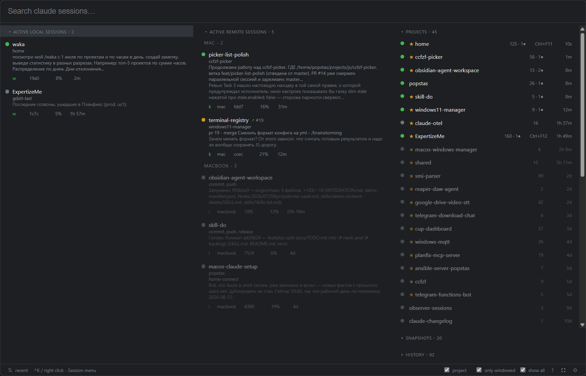
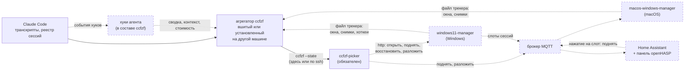

# ccfzf-picker

Пикер сессий Claude Code, живущих на удалённой машине. Список приезжает по ssh
из агрегатора `ccfzf --state`, окно и глобальные хоткеи — Tauri 2, сессия
открывается в терминале по вашему выбору.



*[English version](README.md)*

## Возможности

- **Поиск по всему списку** — строка сверху, фильтрует все панели разом. Пять
  префиксов режима (`/l`, `/r`, `/h`, `/p`, `/s`) оставляют на экране одну
  панель. Забытая раскладка не мешает: `зшслук` находит `picker`.
- **Свои живые сессии** — слева. Панель показывается всегда, даже пустой.
- **Чужие живые сессии** — посередине, одним блоком; машины названы
  подзаголовками (`mac`, `macbook`) и стоят по свежести.
- **Проекты** — справа: звёздочка избранного, число сессий и живых среди них
  (`125 · 1●`), проектный хоткей (`Ctrl+F11` открывает терминал в каталоге
  проекта мимо пикера) и давность последней работы. Кружок слева различает
  три состояния: зелёный — есть живые сессии, серый — были, прозрачный — не
  было ни одной. Проекты с живыми сессиями стоят первыми, за ними остальные;
  внутри каждой половины — по свежести.
- **Наведение или выбор на строке проекта приглушает чужие строки** — видно,
  что принадлежит проекту, а что нет, во всех панелях сразу. В списке из
  одних проектов не включается: отделять там нечего.
- **Строка сессии** — имя, проект, последний запрос человека и ответ агента.
  Устаревшие приглушены — и вместе с ними те, чьё окно свёрнуто на этой
  машине; галка `dim stale` это выключает. Приглушённые строки не идут и в
  раскладку плиткой. Одноимённые сессии
  различаются пометкой: сперва именем машины, а если и оно совпало — хвостом
  id.
- **Кружок состояния** — зелёный: агент работает; жёлтый: спрашивает;
  оранжевый: закончил, результат ещё не смотрели; циан: ход закончен, но
  идёт фоновая команда (её начало — строкой `shell: …` в карточке; нужен ccfzf с полем
  `shell`); серый: простаивает; прозрачный: сессия закрыта.
- **Колонки строки** — буква терминала, в котором открыто окно (`k` — kitty,
  `i` — iTerm2, `z` — WezTerm), машина, короткий id сессии, занятая доля
  контекста (светлеет с 15%, жёлтая с 30%, красная с 40%; пороги — в настройках),
  минуты до истечения кеша промпта (жёлтые меньше 30, красные меньше
  15), возраст последней активности. Какие колонки рисовать — настройка.
- **Ссылка на PR** — `↗ #19` у сессии, из которой он открыт.
- **Сессии Claude Desktop** помечены буквой `c` в колонке окна, и Enter
  возвращает их в само приложение, а не открывает терминал. Прежняя дорога
  осталась пунктом `Resume in terminal` в меню `^K`. Работает у сессий этой
  же машины: приложение поднимает сессию по транскрипту, а тот лежит там, где
  её открывали.
- **Меню `^K`** — действия над сессией; пункт срабатывает голой буквой, без
  Ctrl. У своих действий из `config.yaml` буква задаётся полем `menuKey`.
- **Ctrl+Enter или Ctrl+клик** — открыть сессию на том экране, где сейчас
  мышь, и оставить окно там: оконный трекер не потянет его ни в место, где эта
  сессия жила вчера, ни под правило из своего конфига. Работает там, где окна
  открывает менеджер (Windows); галку `Open sessions on active display` при
  этом не спрашивает — она про все открытия сразу, а модификатор про одно.
- **Панели сворачиваются и переставляются** — `Snapshots - 20` и
  `History - 92` свёрнуты, счёт виден и так; заголовок таскается мышью между
  колонками, порядок переживает перезапуск. Колонок в широком режиме по
  умолчанию три, а перетаскиванием — до пяти.
- **Статуслайн** — сортировка, подсказка меню `^K`, галки-фильтры (`project`,
  `only windowed`, `show all`, `dim stale`), справочник клавиш, переключатель
  широкого режима и шестерёнка настроек.

## Стек

Пикер — одна часть небольшого стека и **единственная обязательная**. Сам по
себе он показывает сессии Claude Code той машины, где запущен: агрегатор вшит
в бинарь. Всё остальное ставится по желанию, и каждая часть добавляет фичи в
то же окно.



| Часть | Когда ставить | Что добавляет |
|---|---|---|
| **ccfzf-picker** | всегда | Список сессий этой машины (`localSource: true`), поиск и режимы, панель проектов, кружки состояния, таймер кеша промпта, Enter — продолжить сессию в терминале или в Claude Desktop, `^O` — папка в редакторе, меню `^K`, широкий режим, окно настроек. Вшитому агрегатору нужны `bash` и `python3` на Linux и macOS, `python` в `PATH` на Windows. |
| **[ccfzf]** на другой машине | агенты работают не здесь | Сессии той машины, по ssh (`sshHost`); там же это и fzf-пикер в терминале. Машина одна или несколько, вместе со своей — списки сливаются. |
| **Хуки агента** (в составе ccfzf) | мало одного состояния | Последний запрос и последний ответ агента под строкой, занятый контекст, стоимость, запрос разрешения, на котором стоит сессия, ссылка на PR, сессия, остающаяся живой через `/clear`. Без хуков состояние, вопрос агента, таймер кеша и пометка сжатия всё равно есть — из хвоста транскрипта. |
| **[windows11-manager]** | Windows | Окна терминалов привязаны к сессиям: буква окна в строке, Enter поднимает открытое окно, а не заводит второе, сессии открываются в своём профиле Windows Terminal, проектные хоткеи, снимки раскладки с восстановлением, раскладки плиткой, каскадом и группой, отметки «просмотрено» и «непросмотрено» общие с трекером и кнопкой на панели задач. С пикером говорит по http, брокер не нужен. |
| **[macos-windows-manager]** | macOS | Окна терминалов привязаны к сессиям, раскладки плиткой и каскадом, снимки раскладки (восстанавливает их сам пикер, сессия за сессией). Подъём окна по Enter и раскладка из пикера требуют брокера MQTT; без него трекер окна всё равно привязывает, а раскладывает из своего меню в трее. |
| **Брокер MQTT** | подъём окон на маке или панель | Транспорт до трекера на маке и для экспорта в Home Assistant, запасной путь до трекера на Windows, если тот не назвал свой http-адрес. |
| **Home Assistant + openHASP** | настенная панель | Сессии строками на сенсорной панели; нажатие поднимает окно сессии. Публикует их windows11-manager по MQTT. |

**windows-mqtt в стек больше не входит.** Всё, что он делал для сессий,
переехало в windows11-manager и пикер; ставить его стоит только ради его
собственных модулей умного дома.

Что в каждой части написано на Rust, Node, Python и shell и где между ними
граница — [docs/stack.md](docs/stack.md).

[ccfzf]: https://github.com/popstas/ccfzf
[windows11-manager]: https://github.com/popstas/windows11-manager
[macos-windows-manager]: https://github.com/popstas/macos-windows-manager

## Установка

### Готовой сборкой

Каждый тег `v*` выкладывает в [релизы][releases] установщик под Windows и
приложение под macOS.

**Windows** — скачайте `*-setup.exe` и запустите. Установка идёт в профиль
пользователя, прав администратора не просит.

**macOS** (Apple Silicon):

```
brew trust --tap popstas/apps
brew install --cask --no-quarantine popstas/apps/ccfzf-picker
```

Homebrew 6.0.0+ не грузит каски из недоверенного тапа, поэтому первой идёт
`brew trust` — один раз на тап, а не на каждое приложение. Отдельный
`brew tap` не нужен: его делает сам `brew install user/tap/cask`.

`--no-quarantine` здесь обязателен: приложение не подписано Developer ID, и
без него Gatekeeper скажет «повреждено» — на поломку сборки это похоже
больше, чем на отсутствие подписи. Intel-маки не поддерживаются: сборка идёт
только под arm64.

[releases]: https://github.com/popstas/ccfzf-picker/releases

### Из исходников

Нужен Rust, Node 22+, `tauri-cli` (`cargo install tauri-cli`) и терминал на
локальной машине; на удалённой — `ccfzf`.
Без `tauri-cli` `cargo tauri build` упадёт с `no such subcommand: tauri`.

Clone with `git clone --recurse-submodules`, or run `git submodule update --init`
in an existing checkout — the vendored `vendor/ccfzf` aggregator is compiled
into the binary, and without it the whole build fails.

```
npm test                      # тесты фронтенда
cd src-tauri && cargo test    # тесты оболочки
cargo tauri build             # сборка
```

## Настройка

Скопируйте `config.example.yml` в `~/.config/ccfzf-picker/config.yaml`
(на Windows — `%USERPROFILE%\.config\ccfzf-picker\config.yaml`) и укажите
`sshHost`. Без него пикер покажет, что конфиг не настроен: умолчания у хоста
нет намеренно.

Каждое поле описано комментарием прямо в `config.example.yml`.

### Sessions from this machine

`localSource: true` adds a second source: the picker runs `ccfzf --state` here,
as a process, without ssh. Both lists are shown as one — a session keeps the
machine of its window, and a session with no window belongs to the source that
reported it.

`ccfzf` is taken from `PATH`. If it is not there, the picker unpacks the copy
built into the binary (`~/.config/ccfzf-picker/ccfzf`) and runs it through
`bash`. `PATH` comes first on purpose: on a machine where `ccfzf` is already
installed, it is the one that rewrites `~/.ccfzf.sessions.json` — the dump the
window tracker, the Home Assistant export and the openHASP panel live on.

`ccfzf` is a bash wrapper around an embedded python program. On native
Windows there is no `bash` to run the wrapper with, so the picker cuts the
python program out of the bundled copy and runs it directly — `python` or
`python3` has to be on `PATH`.

With `localSource` on, `sshHost` may be left empty — one source is a working
setup. Local sessions get no window mark and no Enter-to-focus until the window
tracker on this machine learns to bind them; that is a separate task.

Если каталоги удалённого хоста примонтированы к этой машине, укажите `pathMap`
— пару «путь там ⇄ путь здесь». По ней пикер добавит к каждой сессии действия
открытия папки из `actions`: проводник, Finder, редактор — что пропишете. Пикер
не знает приложений по имени, он подставляет путь в `argv` и запускает; команду
и хоткей задаёте вы. Пункт меню `^K` можно вдобавок повесить на голую букву —
`menuKey`; она работает только при открытом меню, поэтому ей достаются и те
буквы, которые пикер держит за собой под Ctrl. Без `pathMap` этих действий не
будет, и сессия, чей каталог лежит вне общего дерева, их тоже не получит.

Если настроен `mqtt` и `windowHost` совпадает с машиной, где видны окна, у
пикера появляется режим снимков — `^S` или `/s` в строке поиска. Снимок
раскладки запоминает оконный трекер, когда состав открытых сессий устоялся;
Enter на заголовке поднимает раскладку целиком, на строке сессии — одну её.
Снимки приезжают тем же ответом агрегатора, что и список; своего клиента у
пикера для них нет.

`^F` разворачивает окно в широкий режим: сессия показана карточкой с запросом
и ответом агента, а группы, проекты и снимки стоят рядом блоками, у каждого
свой скролл. `↑/↓` ходят внутри блока, `←/→` — между блоками. Всё остальное —
поиск, префиксы, действия, Enter — работает так же, как в узком списке;
режим помнится в `ui.json` и переживает перезапуск.

## Настройки

Окно настроек открывается шестерёнкой справа в статуслайне или `Ctrl+,`
(`Cmd+,` на маке). Слева вкладки, справа страница:

- **General** — хост с сессиями, терминал, показывать ли только работающие
  сессии, гасить ли окно при потере фокуса, опрашивать ли при закрытом окне,
  приглушение устаревших сессий и проектов, имя этой машины (по нему Enter
  решает, поднимать ли уже открытое окно).
- **Window popup** — по ширине и высоте на каждую раскладку, узкую и широкую:
  радиокнопка `Default` (встроенный размер, одинаковый на любом экране) или
  доля экрана, либо своё число пикселей в поле рядом. На большом мониторе
  `80% of screen` по высоте узкого списка вмещает заметно больше сессий. Тут
  же — приглушение рабочего стола позади пикера, отдельной галкой на каждую
  раскладку.
- **Columns** — по каждой колонке две галки: `list` — рисовать ли колонку в
  строке, `statusline` — выносить ли её галку в строку внизу. Место в
  статуслайне ограничено, и что туда попадёт, решаете вы.
- **Layout panels** — порядок, свёрнутость и видимость панелей широкого
  режима (`^F`): какую колонку занимает панель и по каким осям. Под широкой
  таблицей — **Column widths in the wide view**: `Equal` или `2/3 and 1/3`;
  со вторым, когда на экране только колонки 1 и 3, первая занимает две трети
  ширины.
- **Hotkeys** — глобальный хоткей пикера, хоткей режима проектов, хоткей
  плитки (просит оконный трекер разложить окна этой машины в порядке списка —
  см. [docs/window-layouts.md](docs/window-layouts.md)), хоткей истории
  (`Ctrl+Win+Shift+F10` на Windows, `Ctrl+Option+Cmd+Shift+C` на маке) и
  проектные хоткеи.
  Комбинация не набирается текстом: нажмите на поле и нажмите клавиши, а
  `Clear` вернёт встроенное умолчание. Тут же — что делают клик и средний
  клик по иконке трея: показать список, показать проекты или разложить окна
  плиткой. Правая кнопка открывает меню трея, и переназначить её нельзя.
- **MQTT** — брокер, через который идут подъём окна, снимки раскладки и
  открытие сессии на машине с оконным трекером.
- **Paths** — соответствие каталогов (`pathMap`) между этой машиной и
  удалённой, редактор для `^O` и галка **Use SSH Remote**: с ней Zed открывает
  удалённую сессию по SSH (`ssh://<sshHost>/<каталог>`), а не с сетевого диска,
  и видит правки агентов вместо того, чтобы молча их затирать. Только Zed;
  `pathMap` для неё не нужен. Действия открытия папки показываются, но правятся
  только в `config.yaml`.

Правка сохраняется сама через 400 мс после паузы в наборе; кнопка Save делает
то же самое сразу, не дожидаясь паузы. Сохранение вкладок Columns и Layout
panels пишет `~/.config/ccfzf-picker/ui.json`, остальных —
`~/.config/ccfzf-picker/config.yaml`. Изменения применяются сразу, включая
хоткеи: перезапуск не нужен.

**`config.yaml` после первого сохранения из окна теряет комментарии.** Файл
переписывается целиком, и сохранить пометки при этом нечем. Прежний файл
остаётся рядом как `config.yaml.bak`, а описание всех ключей всегда лежит в
`config.example.yml`. Оба файла сохранение закрывает от посторонних (`0600`
там, где права такие есть): в конфиге лежит пароль брокера.

## Фоновое обновление

Пикер опрашивает агрегатор и при закрытом окне: раз в минуту, а при тишине
реже — 2, 4, 8 минут, — и снова раз в минуту, как только что-то изменилось.
Так список готов к следующему открытию, а `ccfzf --state` держит свежим свой
дамп, с которого живут экспорт в Home Assistant и панель openHASP. Выключается
ключом `backgroundRefresh: false`.

## Как устроено

- `frontend-src/` — чистые функции и отрисовка, каждый файл в UMD-шиме:
  работает и как `<script>`, и как CommonJS-модуль в тестах. Порядок тегов в
  `sessions.html` — часть контракта: модуль берёт соседа из `globalThis` в
  момент загрузки. Сторожит это `test/frontend-load.test.js`.
- `sessions.html` — окно пикера: разметка, стили и вся запись в DOM.
- `src-tauri/` — оболочка: окно, трей, глобальные хоткеи, чтение конфига,
  вызов ssh.
- `scripts/prepare-frontend.js` — собирает статику в `frontend/` копированием,
  без сборщика. Запускается из `beforeBuildCommand` в Tauri.
- `scripts/check-state.js` — прогон живого ответа агрегатора через ту же
  проверку формы, что и тесты: `ccfzf --state | node scripts/check-state.js`.
- `scripts/make-icons.py` — иконки приложения из иконки трея:
  `python3 scripts/make-icons.py`. Руками рисуется только
  `src-tauri/icons/favicon.png`, остальное в `src-tauri/icons/` — вывод скрипта.

Тесты — только `node --test`, без зависимостей. Запускать `npm test`;
`node --test test/` на этих версиях Node не работает. Агрегатор здесь не
лежит и не проверяется: он живёт своим репозиторием со своими тестами, пути
выписаны в скилле `/claude-wt`.

## Документы

- [CLAUDE.md](CLAUDE.md) — как собирать и какие правила уже оплачены багами.
- [docs/stack.md](docs/stack.md) — Rust, Node, Python и shell в каждой части стека.
- [docs/TODO.md](docs/TODO.md) — что отложено и почему.
- [docs/window-layouts.md](docs/window-layouts.md) — как просить оконный трекер
  расставить окна плиткой или каскадом.
